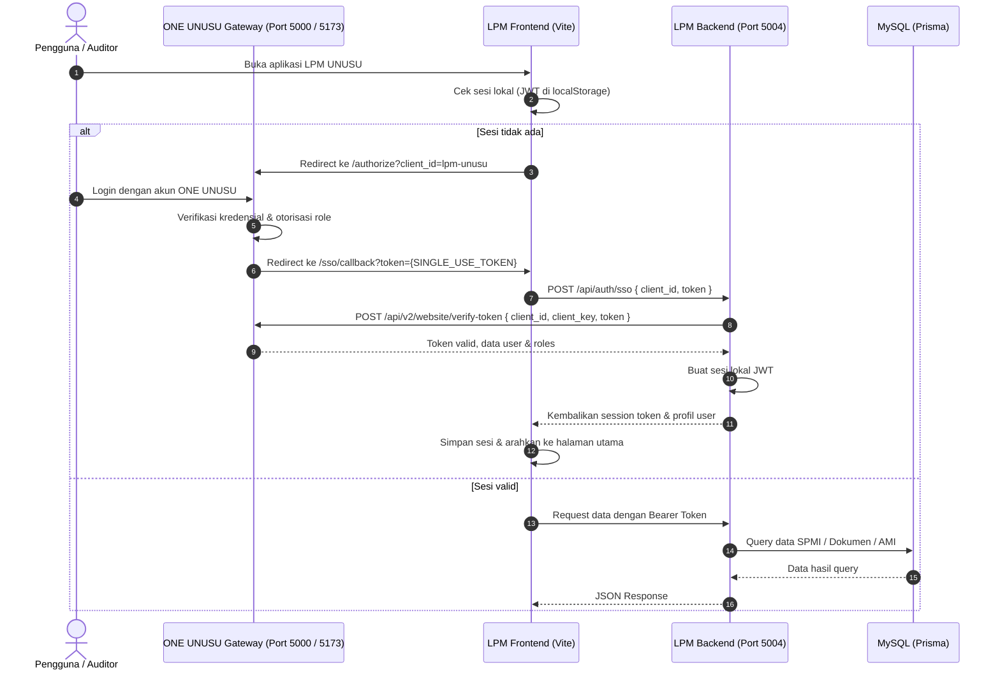

# Architecture — LPM UNUSU

## 1. Arsitektur Umum
LPM UNUSU dibangun dengan pola **Fullstack Monolith** terpisah secara modular:
- **Frontend**: Vite + React 18 SPA (`src/client`) dengan Tailwind CSS dan Heroicons.
- **Backend API**: Node.js Express (`src/server/index.ts`) melayani REST API di port 5004.
- **Database**: MySQL dengan Prisma ORM (`prisma/schema.prisma`).

## 2. Diagram Alur Autentikasi SSO Single-Use Token

## 2a. Cakupan Admin per Aplikasi (App-Scoped Admin)

Setiap aplikasi dalam ekosistem ONE UNUSU memiliki peran adminnya sendiri. **Peran admin tidak dapat dipakai lintas aplikasi.**

| Peran SSO | Aplikasi pemilik | Akses panel LPM |
| --- | --- | --- |
| `SUPERADMIN` | Portal ONE UNUSU | Diizinkan (lintas aplikasi) |
| `ADMIN_LPM` | LPM UNUSU | Diizinkan |
| `DOSEN` | LPM UNUSU (auditor internal) | Diizinkan |
| `ADMIN_LPPM`, `ADMIN_ESURAT`, `ADMIN_SARPRAS`, `ADMIN_AKREDITASI`, `ADMIN_LMS`, `ADMIN_SSO` | Aplikasi lain | **Ditolak** (`FOREIGN_APP_ADMIN`) |

Penegakan dilakukan di tiga lapis:

1. **Tukar token SSO** (`POST /api/auth/sso`) — `resolveAppAccess()` memeriksa peran; peran aplikasi lain dibalas `403` dengan `code: FOREIGN_APP_ADMIN` dan tidak menerima JWT. JWT yang sah memuat `appCode: lpm-unusu` sebagai penanda cakupan.
2. **Middleware `authenticate`** — peran di dalam JWT divalidasi ulang pada setiap request, sehingga token lama (sebelum pemisahan) tidak dapat dipakai. Penolakan dibalas `403` dengan `appAccess` + `code`.
3. **Klien** — `AuthContext` menurunkan `appAccess`/`accessDenied`, `ProtectedRoute` mengalihkan ke `/akses-ditolak`, menu RBAC disembunyikan bila `!isAppAdmin`, dan sesi divalidasi ulang (`/api/auth/me`) saat tab kembali aktif (throttle 60 detik).

Penolakan tercatat pada buffer in-memory (`recordAccessDenial`, maks 100 entri) dan dapat diaudit Administrator LPM melalui `GET /api/security/access-denials` serta panel "Jejak Penolakan Akses Lintas Aplikasi" di halaman Peran & Izin.

## 3. Skema Data (Prisma ORM)
1. **`StandarSpmi` (`lpm_standar_spmi`)**:
   - `id`, `kode`, `nama`, `kategori`, `pernyataan`, `indikator`, `target`, `tahun`
   - Relasi: One-to-Many ke `DokumenMutu` dan `AuditButir`.
2. **`DokumenMutu` (`lpm_dokumen_mutu`)**:
   - `id`, `standarId`, `kode`, `judul`, `tipe` (Kebijakan, Manual, Standar, SOP/Formulir), `nomorSk`, `tahun`, `fileUrl`
3. **`PeriodeAmi` (`lpm_periode_ami`)**:
   - `id`, `tahun`, `semester` (Ganjil/Genap), `nama`, `status` (DRAFT, BERJALAN, SELESAI), `tglMulai`, `tglSelesai`
   - Relasi: One-to-Many ke `AuditButir`.
4. **`AuditButir` (`lpm_audit_butir`)**:
   - `id`, `periodeId`, `standarId`, `auditee` (Prodi/Unit Kerja), `auditor`, `hasil` (TERLAMPAUI, SESUAI, KTS_MINOR, KTS_MAYOR, OBSERVASI), `deskripsi`, `rekomendasi`
