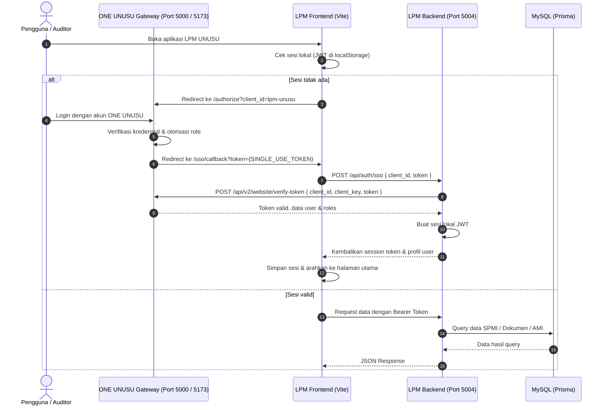

# Architecture — LPM UNUSU

## 1. Arsitektur Umum
LPM UNUSU dibangun dengan pola **Fullstack Monolith** terpisah secara modular:
- **Frontend**: Vite + React 18 SPA (`src/client`) dengan Tailwind CSS dan Heroicons.
- **Backend API**: Node.js Express (`src/server/index.ts`) melayani REST API di port 5004.
- **Database**: MySQL dengan Prisma ORM (`prisma/schema.prisma`).

## 2. Diagram Alur Autentikasi SSO Single-Use Token

## 3. Skema Data (Prisma ORM)
1. **`StandarSpmi` (`lpm_standar_spmi`)**:
   - `id`, `kode`, `nama`, `kategori`, `pernyataan`, `indikator`, `target`, `tahun`
   - Relasi: One-to-Many ke `DokumenMutu` dan `AuditButir`.
2. **`DokumenMutu` (`lpm_dokumen_mutu`)**:
   - `id`, `standarId`, `kode`, `judul`, `tipe` (Kebijakan, Manual, Standar, SOP/Formulir), `nomorSk`, `tahun`, `fileUrl`
3. **`PeriodeAmi` (`lpm_periode_ami`)**:
   - `id`, `tahun`, `semester` (Ganjil/Genap), `nama`, `status` (DRAFT, BERJALAN, SELESAI), `tglMulai`, `tglSelesai`
   - Relasi: One-to-Many ke `AuditButir`.
4. **`AuditButir` (`lpm_audit_butir`)**:
   - `id`, `periodeId`, `standarId`, `auditee` (Prodi/Unit Kerja), `auditor`, `hasil` (TERLAMPAUI, SESUAI, KTS_MINOR, KTS_MAYOR, OBSERVASI), `deskripsi`, `rekomendasi`
